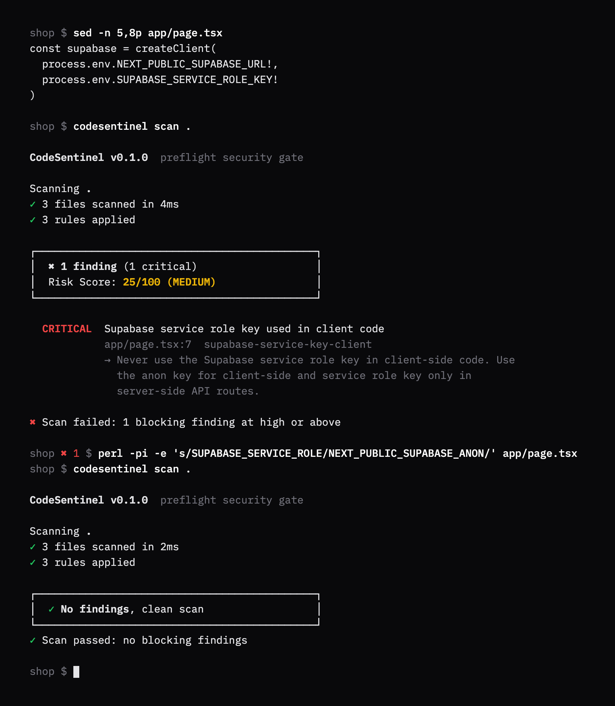

# CodeSentinel

Fails your build when a secret, an env leak or an unverified Stripe webhook is about to ship. Point it at a Next.js project and it reads the source, config and `.env` files, applies five deterministic rules, prints each finding with the rule, the line and the fix, and exits 1 when something blocks.

[](https://github.com/matuskalis/codesentinel/actions/workflows/ci.yml) [](LICENSE)



This is a real session, not a mockup. `scripts/render-demo.mjs` copies `fixtures/next-supabase-service-key-client`, runs the built CLI on it, and renders the output and exit codes it captured. The red `1` in the prompt is the exit status of the scan before it.

What happened: rule `supabase-service-key-client` matched `SUPABASE_SERVICE_ROLE_KEY` in `app/page.tsx`, a `'use client'` file. That key bypasses Row Level Security, and a client component ships to every visitor's browser. The fix is the anon key. The second scan is clean and exits 0.

The line `3 rules applied` counts the registered rules that had at least one file to read in this scan: three of the five. `env-committed` and `next-public-secret` only read `.env` files, and this fixture has none.

## Quickstart

CodeSentinel is version 0.1.0 and is not on npm. Build it from source. Building needs Node 20.11 or newer and pnpm (9 and 11 tested). The bundle it produces has no dependencies beyond Node itself.

```bash
git clone https://github.com/matuskalis/codesentinel.git
cd codesentinel
pnpm install
pnpm cli:build
node dist/codesentinel.mjs scan fixtures/next-supabase-service-key-client
```

The last command prints the finding from the screenshot and exits 1. Scan your own project the same way:

```bash
node dist/codesentinel.mjs scan /path/to/your/project --fail-on high
```

## GitHub Action

```yaml
# .github/workflows/security.yml
name: Security scan
on: [push, pull_request]

permissions:
  contents: read

jobs:
  scan:
    runs-on: ubuntu-latest
    steps:
      - uses: actions/checkout@v4
      - uses: matuskalis/codesentinel@v1
        with:
          fail-on: high
```

`@v1` is the v0.1.0 release tag and carries this `action.yml` and `dist/action.mjs`. `@main` also has the fixes merged after it (path skipping, git-ignore awareness, no 500-file cap), which are not in a tag yet.

Inputs: `directory` (default `.`) and `fail-on` (default `high`). Outputs: `findings-count`, `risk-score`, `risk-level`. Every finding becomes an annotation on its line (error for critical and high, warning for medium, notice for low), and the step fails when a finding blocks or when the time limit cuts the scan short (exit 3). The action is composite: it sets up Node 20 and runs the committed bundle, so there is no install or build step. CI rebuilds `dist/` on every push and fails when the committed copy differs.

## What it catches

Five rules are registered. These are the ones the CLI, the Action and the App run.

| Rule | Severity | Confidence | Flags | Stays quiet for |
|---|---|---|---|---|
| `hardcoded-secrets` | critical (Stripe test keys: medium) | high | Stripe `sk_live_` and `sk_test_`, AWS access key ids, GitHub `ghp_` tokens, OpenAI `sk-` keys, SendGrid, Slack bot tokens, JWTs, in ts, js, json, yaml and env files | test files, `.example` `.sample` `.template` files, fixture and snapshot paths, generated API docs, comments, lines that read `process.env`, placeholder values, the jwt.io sample token, Supabase anon-role JWTs, git-ignored files |
| `env-committed` | critical | high | `.env`, `.env.local`, `.env.production`, `.env.development` holding a real-looking value: a known key shape, a database URL with credentials, or a secret-looking name (`SECRET`, `_KEY`, `TOKEN`, `PASSWORD`, `PRIVATE`, `CREDENTIAL`) with a real value | `.env.example` `.sample` `.template`, placeholders, empty values, localhost URLs, git-ignored untracked files |
| `next-public-secret` | high | high | `NEXT_PUBLIC_*` variables named like a secret, key, token or password with a non-placeholder value, which Next.js inlines into the browser bundle | `SUPABASE_ANON_KEY`, `PUBLISHABLE_KEY`, `PUBLIC_KEY`, `CLOUDINARY_API_KEY`, `pk_` values, plain URLs |
| `stripe-no-webhook-verify` | high | medium | API routes that import Stripe, have a webhook-looking path and a POST handler, and never mention `constructEvent`, `stripe-signature`, `webhookEndpointSecret`, `webhook_secret` or `whsec_` | anything that mentions those, non-webhook routes, tests |
| `supabase-service-key-client` | critical | high | `SUPABASE_SERVICE_ROLE_KEY`, `supabaseServiceRoleKey`, `service_role`, `serviceRole` in files classified as client code | server files, route handlers, comments, tests |

Seven more rules are written and unit-tested in `src/lib/rules/` (`dangerous-innerhtml`, `exposed-service-keys`, `insecure-cookie-flags`, `insecure-jwt`, `permissive-cors`, `sql-injection`, `unsafe-eval`) but are not registered, so nothing runs them. The first commit calls the five above the "trust core". Enabling another is one line in `allRules`.

## How it decides

```
files on disk -> walker -> classifier -> rules -> dedupe -> score -> exit code
```

- The walker skips `node_modules`, `dist`, `build`, `.next`, `coverage`, lockfiles, images, fonts and archives by path segment, and files over 512 KB. `src/rebuild/` is scanned, `build/` is not.
- The classifier labels each file: language, client or server context (a `'use client'` line, `/components/`, `/hooks/`, route handlers, `'use server'`), route type, and whether it is a test.
- A rule only sees files it applies to, and the `N rules applied` line in the output counts the rules that had at least one file to read. Test files are skipped by the rules that say so.
- Findings are deduplicated by fingerprint, a SHA-256 of rule id, path and the whitespace-normalised snippet.
- The exit code is decided by severity and confidence, not by the score.

**Determinism.** Same input, same findings, byte for byte, apart from the scan duration. No rule uses the network, a model, a random number or the clock. The scanner reads the clock only for the duration it reports and for a two-minute safety timeout. Tests scan every fixture twice and compare, and compare the CLI's JSON findings across two runs.

**False positives.** Each rule carries its own exclusions (the last column above). The one heuristic rule, `stripe-no-webhook-verify`, is marked medium confidence, and medium-confidence findings never fail a build (see below). The fixtures pin negative controls: a server route that uses the service key, a fixed webhook, the anon key and the publishable key in an env file.

**Thresholds.** `--fail-on <level>` defaults to `high`. A finding blocks when its severity is at or above the level and its confidence is high. `--fail-on low` blocks on any finding. A finding that is printed but does not block says so in the pass message.

**Risk score.** Severity weight (critical 25, high 15, medium 8, low 3) times confidence weight (high 1, medium 0.6, low 0.3), summed and capped at 100. 0 to 20 is low, 21 to 50 medium, 51 to 80 high, 81 and up critical. It is a summary for people: one critical finding scores 25 and reads MEDIUM. Gate on the exit code.

## CLI

```
codesentinel scan [directory]
  --fail-on <level>   critical, high, medium or low (default high)
  --json              print the result as JSON
  --quiet             print nothing, exit code only
  --version, --help
```

Exit codes: `0` the scan finished and nothing blocks, `1` a finding blocks, `2` usage error (unknown flag, missing directory, bad level or time limit), `3` the time limit cut the scan short and nothing in the part that was scanned blocks. An incomplete scan prints a warning and is never a `0`. The limit is two minutes, and `CODESENTINEL_SCAN_TIMEOUT_MS` changes it.

`--json` prints `findings` (each with `ruleId`, `severity`, `confidence`, `title`, `description`, `explanation`, `fixSuggestion`, `filePath`, `startLine`, `endLine`, `snippet`, `fingerprint`), `riskScore`, `riskLevel` and `summary` (`totalFindings`, `bySeverity`, `filesScanned`, `filesNotScanned`, `rulesApplied`, `scanDurationMs`).

## Evidence

Numbers from runs at this commit, on an M1 Pro.

- **Tests:** 536 passing in 29 files (`pnpm test:run`, about 15 seconds). They cover each rule with positive and negative cases, the scanner, scoring, the walker, the formatter, the CLI through its exit codes, and the committed `dist/` bundles the Action runs.
- **Fixtures:** `pnpm fixtures` scans 3 fixtures (7 files) and finds 6 of 6 expected findings with 0 unexpected ones. These are hand-written regression cases, not a benchmark. They show the rules still do what they were written to do, not how often they are right on other people's code.
- **Real-world precision and recall:** not measured here. Earlier runs over public repositories are not reproduced in this repository, so this README makes no claim about them.
- **Speed:** scanning this repository (149 files) takes a median of 11 ms inside the scanner and 78 ms wall clock including Node start-up and the git check (21 runs). The laptop was under heavy load, so read these as upper bounds.
- **Size:** the CLI bundle is 37.6 KiB and the Action bundle 32.8 KiB. Both import only Node built-ins.
- **CI:** typecheck, tests, CLI and dashboard builds, a check that committed `dist/` equals a fresh build, a scan of `src/` that fails on any finding, and the Action itself run on two fixtures.

## Design decisions and what they cost

1. **Pattern rules over file paths and text, not a parser or data flow.** Reproducible, explainable, dependency-free, tens of milliseconds. The cost: it cannot follow a key through a helper, a webhook verified in another module is reported, and it only knows the key shapes listed above.
2. **Confidence decides the exit code.** The one noisy rule cannot break a build. The cost: a HIGH finding can be printed while the scan exits 0, and `--fail-on low` is the only way to make every finding block.
3. **`dist/` is committed.** The Action is a single `uses:` line with nothing to install. The cost: generated code in the repository, kept honest by the CI check that rebuilds it.

## Limits

- **Files on disk.** The CLI scans a directory, not a commit. Inside a git repository it asks `git check-ignore` which files `.gitignore` covers and skips the two committed-secret rules for those untracked files (tracked files are still checked). Outside a repository, or without `git` on the PATH, a local `.env.local` is reported as committed. If a parent repository ignores the scan root itself (a vendored copy, say), the git signal is dropped and every file is scanned. `next-public-secret` still reads git-ignored env files, because the value reaches the bundle either way.
- **Time limit.** A scan stops after two minutes (`CODESENTINEL_SCAN_TIMEOUT_MS` changes it, in milliseconds). It then prints how many files it never reached, says the scan is incomplete, and exits 3, so a cut-off scan cannot pass as clean. This repository scans in about 11 ms, so the limit only matters for very large trees.
- **File types.** Only `.ts .tsx .js .jsx .mjs .cjs .json .yml .yaml` and `.env*`. Nothing for Python, Go, Dockerfiles or Markdown. No entropy detection.
- **Client context is inferred.** A helper that a client component imports is not followed.
- **No suppression.** There is no ignore file, inline comment or config. A false positive cannot be silenced in the CLI or the Action, only fixed or kept below the threshold. The GitHub App's dashboard can mute a rule.
- **Not tested:** Windows, Node 18 (the bundle is built for it), pnpm 10.
- **GitHub App prototype.** `src/app`, `src/lib/github`, `src/lib/jobs`, `src/lib/db` and `worker/` hold a webhook, a BullMQ worker, a Postgres schema and a Next.js dashboard that reuse the same scanner. The CLI and the Action do not need them. The dashboard builds (`pnpm build`). The webhook and worker path is not verified end to end here, because it needs a GitHub App and its credentials (`.env.example` lists them).

## Development

```bash
pnpm install
pnpm typecheck
pnpm test:run     # all tests
pnpm fixtures     # fixture regression with a recall and precision summary
pnpm cli:build    # writes dist/, commit it
```

`fixtures/README.md` explains the fixtures and how to add one. `CLAUDE.md` has the project conventions and the steps for adding a rule.

## License

MIT, see `LICENSE`.
